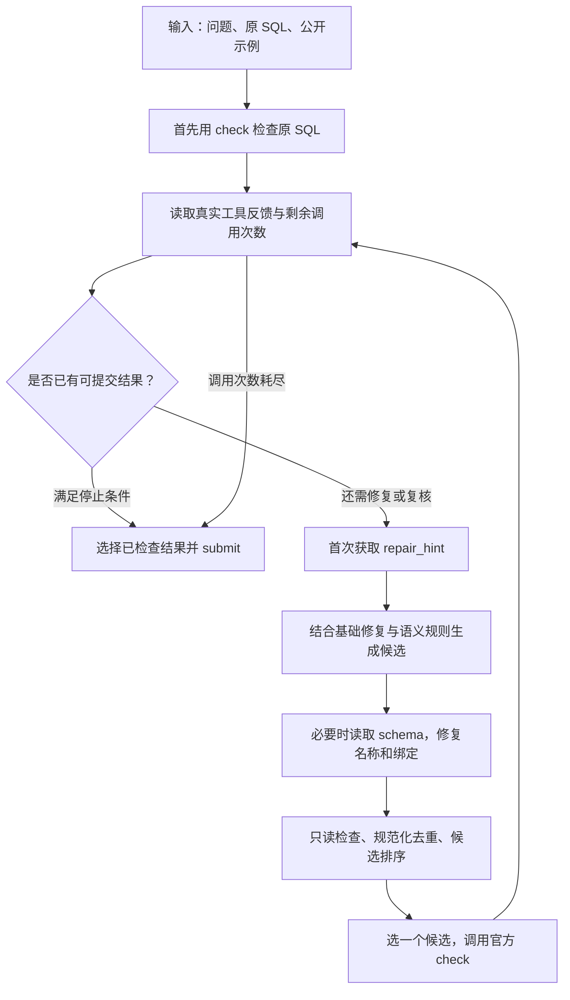

# SQL Repair Agent 后续实验

本轮探索的目标是提高 SQL 修复准确率，同时保留可复现的对照。配置由官方验证集评分选出，冻结后只对这个候选进行了一次官方测试集检验。

**选定 `final_no_composition` 在 Linux 官方测试中得到 182/240（75.83%），比原版 175/240（72.92%）净增 7 题、2.92 个百分点。** 验证集也净增 7 题；两个数据集题数不同，准确率增幅不同。

| 指标 | 原版 | 本轮选定版本 |
|---|---:|---:|
| 验证集正确题数及准确率 | 91/120，75.83% | 98/120，81.67% |
| Linux 测试集正确题数及准确率 | 175/240，72.92% | 182/240，75.83% |
| 测试集平均工具调用次数 | 2.9625 | 3.4208 |

新版测试证据见 [官方原始评分](results/linux/test-score.json)、[对照与文件校验记录](results/verification.json) 和 [GitHub Actions 运行](https://github.com/gy13687638535-design/DASE7506-MP3-SQL-Repair/actions/runs/43157511762)。原版评分保存在 [outputs/test-score.json](../outputs/test-score.json)。这些是学生侧使用官方工具得到的结果，尚不代表课程方最终确认。

本轮仍是 CPU 上的程序策略优化，没有训练模型、没有使用在线语言模型，也没有 LoRA 权重。官方接口中的 `--checkpoint` 在这里接收一个 JSON 配置文件；这个参数名不代表进行了模型训练。

原版 [submission](../submission/)、[outputs](../outputs/) 和 [课程提交 Issue #387](https://github.com/xudongwu-0/xudongwu-0.github.io/issues/387) 保持冻结；本目录保存独立的探索候选。

## 代码怎样组织

```text
experiments/
├── v2/                         新版 Agent，可独立作为 method 加载
│   ├── submission.py           决策控制器：下一步检查、提示、读结构还是提交
│   ├── repairs.py              基础 SQL 修复：列、表、连接、分组、排序等
│   ├── semantic_repairs.py     新增语义候选：否定、ANY、聚合、数值比较等
│   ├── ranking.py              用固定规则比较已经检查过的候选
│   └── config.json             选定配置；不是模型权重
├── configs/                    15 个实验配置，供对照与复现
├── evaluate.py                 批量调用官方预测器、评分器，记录验证结果
├── measure.py                  调用同一官方流程，并记录时间和资源使用
├── test_semantic.py            语义转换的人工构造测试
├── test_ranking.py             候选评分的人工构造测试
├── test_experiment_audit.py     独立审查发现的问题的回归测试
└── results/                    官方预测、原始评分、摘要和运行日志

.github/workflows/explore.yml   在 Linux 上运行选定版本并保存结果
```

Agent 的实际工作流程如下。`evaluate.py` 和 `measure.py` 是外部实验程序，不会给 Agent 提供评分器的参考答案。



公开示例匹配只能说明 SQL 在这一个示例上产生了相同结果；它不是对全部数据库实例正确性的证明。例如，两条错误 SQL 都返回空表，也可能得到“匹配”的反馈。官方评分器会进一步检查每题的多个实例。因此，选定版本增加了受限的复核，并保留已经成功检查过的 SQL 作为回退。

## 实际改了什么

| 改动 | 作用 | 选定配置中的状态 |
|---|---|---|
| `semantic` | 从问题和 SQL 结构生成更丰富的修复候选 | 开启 |
| `verify_all_matches` | 原 SQL 即使匹配公开示例，也先请求提示，并在存在可用候选时再检查 | 开启 |
| `hint_only_pass` | 已有匹配结果后，后续尝试限制为提示来源的候选，避免继续任意改写 | 开启 |
| `rank_matches` | 多条已检查 SQL 都匹配时，用固定结构评分选择；空表或全 NULL 示例仍保留原有选择方式 | 开启 |
| `compose_projection` | 对整个候选池进行投影预组合：额外叠加输出列改写，并提高其优先级 | **关闭** |
| `refine_matches` | 匹配后仍用启发式评分寻找“更好”的候选 | 关闭 |

关闭 `compose_projection` 的准确含义是“关闭全候选池投影预组合”，不等于取消全部组合修复。`semantic_repairs.py` 仍会生成保留别名和排序引用的 `compositional_projection` 候选，部分语义规则也会在修复后的投影上继续生成候选；关闭的是控制器对整个候选池额外叠加的那一层改写。`safe_projection` 仍写在冻结配置中，但该开关仅在控制器的额外组合步骤开启时生效。

新语义规则包括：

- 把“从未发生某事件”与“不等于某个值”区分开，提出相关 `NOT EXISTS` 候选。
- 对明确的存在性 `ANY` 比较提出 `MIN`/`MAX` 边界修复。
- 修复输出列时，同时维护被删除的别名引用、`ORDER BY 2` 等位置引用，以及相关聚合表达式。
- 对问题中明确出现的数值条件提出数值转换候选；对可能多余的连接或分组提出删除候选。

这些是需要执行验证的假设，并非永远成立的等价改写。例如，删除一个没有出现在输出列中的连接仍可能改变行数；因此不能只凭规则认定 SQL 正确。候选必须经过官方 `check`，程序遵守最多 8 次计费工具调用的预算。

`ranking.py` 也没有经过训练。它依据输出列结构、聚合、去重、否定条件、连接和已知结构等特征打分；分数不表示正确概率。它只辅助从已检查且匹配的结果中选择，不能替代执行反馈。对信息很弱的空表、全 NULL 示例，不启用这种排序，以免偏爱较短但语义错误的 SQL。

## 实验结果与证据

下列数字来自未修改的官方评分器；摘要程序只提取 `correct`、`n`、`accuracy` 和 `mean_tool_calls`。本节的验证实验在 Windows 开发环境运行，资源限制是否满足应以选定版本的 Linux 测量为准。

原版验证成绩及平均工具调用次数的证据是 [validation-score.json](../outputs/validation-score.json)：91/120，75.83%，2.825 次/题。

前 10 组属于开发过程中的历史探索，期间逐步加入功能。它们用于记录尝试过的方向，**不能全部视为同一份最终代码上的严格消融**。当前代码重新运行这些早期配置，结果可能与历史记录不同。

| 历史配置及摘要 | 主要尝试 | 正确题数 / 120 | 准确率 | 平均工具调用 |
|---|---|---:|---:|---:|
| [verify_all](results/validation-verify_all-summary.json) | 对所有初始匹配进行复核 | 91 | 75.83% | 3.575 |
| [projection_first](results/validation-projection_first-summary.json) | 优先修复输出列 | 91 | 75.83% | 2.858 |
| [compose](results/validation-compose-summary.json) | 在候选上组合输出列修复 | 92 | 76.67% | 2.683 |
| [recency](results/validation-recency-summary.json) | 优先从最近检查的 SQL 继续修复 | 91 | 75.83% | 2.758 |
| [combined](results/validation-combined-summary.json) | 合并以上四项策略 | 91 | 75.83% | 3.517 |
| [safe_verify](results/validation-safe_verify-summary.json) | 复核、匹配后限制候选、匹配结果排序 | 94 | 78.33% | 3.433 |
| [semantic](results/validation-semantic-summary.json) | 新语义修复候选 | 94 | 78.33% | 2.800 |
| [semantic_compose](results/validation-semantic_compose-summary.json) | 语义修复与输出列组合 | 94 | 78.33% | 2.675 |
| [strong](results/validation-strong-summary.json) | 语义修复、组合、受限复核和排序 | 97 | 80.83% | 3.308 |
| [refine](results/validation-refine-summary.json) | 匹配后继续搜索，并扩大启发式排序作用 | 91 | 75.83% | 2.900 |

独立代码审查随后发现并修复了三个问题：输出列改变后仍沿用旧位置引用、把窗口聚合误当作需要分组的普通聚合，以及针对歧义列错误生成不必要的新表连接。相应测试使用人工构造的内存 SQLite 数据，不读取基准题目。新增实验测试共 28 项，均已通过。

以下 5 组均在上述修复后的同一版本代码上重新运行，可以进行配置对照。配置名称中的 `final` 是实验名称，不表示它必然是最终选择。

| 最终对照配置及原始评分 | 相对于 `final` 的变化 | 正确题数 / 120 | 准确率 | 平均工具调用 |
|---|---|---:|---:|---:|
| [final](results/validation-final-score.json) | 语义、组合、复核、排序均开启 | 97 | 80.83% | 3.308 |
| [final_no_semantic](results/validation-final_no_semantic-score.json) | 关闭语义模块及其安全输出列组合实现 | 94 | 78.33% | 3.300 |
| [final_no_verification](results/validation-final_no_verification-score.json) | 关闭对所有匹配的复核，仍保留原有弱示例复核 | 95 | 79.17% | 2.658 |
| [final_no_ranking](results/validation-final_no_ranking-score.json) | 关闭匹配结果的结构评分 | 97 | 80.83% | 3.308 |
| **[final_no_composition](results/validation-final_no_composition-score.json)** | **关闭全候选池投影预组合** | **98** | **81.67%** | **3.425** |

`final_no_semantic` 同时关闭了 `semantic` 和 `safe_projection`，所以它检验的是这一组语义相关实现的贡献，不能把差值全部归因于某一条规则。其余对照也只能说明这些策略在当前组合和这份验证集上的效果。

已经验证的结论是：选定版本比原版多答对 7 题；代价是验证集平均工具调用从 2.825 增加至 3.425，约增加 21.2%。关闭额外组合层后，比全开配置多答对 1 题。取消匹配结果排序在该对照中没有改变总正确数，因此没有证据表明它在这里单独带来了准确率收益。

更激进的 `refine` 历史实验只得到 91/120。一个合理解释是，启发式分数与真实正确性并不等价，扩大它对候选保留和提交的影响会选错答案；这属于根据代码行为提出的解释，尚未用单独受控实验拆分每个开关的因果作用。结果已足以说明“搜索更激进”不保证更好。

## 冻结版本的测试结果

选定配置为 [v2/config.json](v2/config.json)，内容对应 [configs/final_no_composition.json](configs/final_no_composition.json)。[selection.json](selection.json) 记录测试前的选择依据、冻结时间和源码哈希。实际运行的代码提交为 [`6f3c2369d1987ae4b1cf2252e1971770fc507c32`](https://github.com/gy13687638535-design/DASE7506-MP3-SQL-Repair/commit/6f3c2369d1987ae4b1cf2252e1971770fc507c32)，运行源码与测试前冻结的哈希一致。

测试时只运行了这个冻结候选，没有用新版测试成绩选择配置。评分完成后，按官方每题通过标记比较两版：174 题两版都对，8 题由错变对，1 题由对变错，57 题两版都错。这解释了 182 − 175 = 7 的净提升，也说明新版并非在每道题上都优于原版。比较仅用于报告，没有根据测试 SQL 或失败案例继续修改 Agent。

测试集平均工具调用从 2.9625 增至 3.4208，约增加 15.47%。[Linux 资源记录](results/linux/test-runtime.json) 显示，预测和评分合计墙钟时间为 20.353 秒，累计 CPU 时间为 60.445 秒；采样进程树峰值 RSS 为 108.246 MiB，虚拟内存为 784.852 MiB。运行设置最多 4 个 CPU、180 秒合计时限及 2 GiB 虚拟内存限制，本次运行成功完成。CPU 时间累加了并行进程的消耗，因此可以大于墙钟时间。不同 GitHub Actions 运行可能分配不同主机，这些测量不能证明新版必然比原版更快。

本轮比较了多个验证配置，仍存在对这份验证集过度适配的风险。冻结后的 182/240 提供了测试集改善的证据，但不能保证对任意新数据库、问题表达或 SQL 错误类型都有同等收益。原课程提交 Issue 未更新，本目录继续作为独立候选保留。

Agent 的信息来源限于题目、待修 SQL、公开示例，以及官方工具返回的提示、检查反馈和结构。Agent 不直接读取数据库文件，不读取评分参考答案，不以题目 ID 建立答案表，也不把公开示例的结果单元格抄写为 SQL 常量。实验程序会在 Agent 运行结束后读取官方评分，用于验证比较。

## 复现方法

使用 Python 3.11 或 3.12，并提前下载原始官方包。以下命令均从仓库根目录执行。固定的依赖是 `sqlglot==27.29.0`；官方包及评分器保持原样。

Linux：

```bash
python3.12 -m venv .venv
source .venv/bin/activate
PACKAGE=/absolute/path/to/MP3_SQL_student_package
python -m pip install -r "$PACKAGE/requirements.txt" -r requirements.txt
(cd "$PACKAGE" && python -m mp3_sql.check_data)
PYTHONPATH="$PWD/experiments/v2" python -m unittest discover -s experiments -p 'test_*.py' -v

# 复现最终五组验证对照；会重写对应 experiments/results/validation-* 文件。
python experiments/evaluate.py --package "$PACKAGE" --split validation --configs \
  final final_no_semantic final_no_verification final_no_ranking final_no_composition

# 固定源码与配置后，单独测量选定版本。
python experiments/measure.py --package "$PACKAGE" --split test \
  --output-dir experiments/results/reproduced-linux
```

Windows PowerShell（已安装 Python 3.12 和 Python Launcher）：

```powershell
py -3.12 -m venv .venv
$Python = (Resolve-Path .venv/Scripts/python.exe).Path
$Package = 'C:\path\to\MP3_SQL_student_package'
& $Python -m pip install -r "$Package/requirements.txt" -r requirements.txt
$env:PYTHONUTF8 = '1'
$env:PYTHONPATH = (Resolve-Path experiments/v2).Path
& $Python -m unittest discover -s experiments -p 'test_*.py' -v
& $Python experiments/evaluate.py --package $Package --split validation --configs final final_no_semantic final_no_verification final_no_ranking final_no_composition
& $Python experiments/measure.py --package $Package --split test --output-dir experiments/results/reproduced-windows
```

`measure.py` 默认加载 `experiments/v2/config.json`，也可通过 `--config` 指定配置。它对预测与评分设置合计 180 秒时限。在 Linux 上，还限制至最多 4 个 CPU、设置每进程 2 GiB 地址空间上限，并采样检查整个进程树的虚拟内存总量；时间和资源报告与官方评分分开存储。Windows 记录只覆盖控制进程，且不执行 Linux 的资源限制，不能把 Windows 数字当成同等资源合规证据。

[Linux 工作流](../.github/workflows/explore.yml) 使用同一测量程序，下载官方 ZIP 后校验 SHA-256，再运行选定版本。官方包 ZIP 的预期 SHA-256 为 `406d69507ccf955a53b35db1c1368bd7452565ebd928b47d0f6161fe35b99a61`。这些结果是学生侧用官方工具得到的可复现结果，课程方最终验证另行进行。
